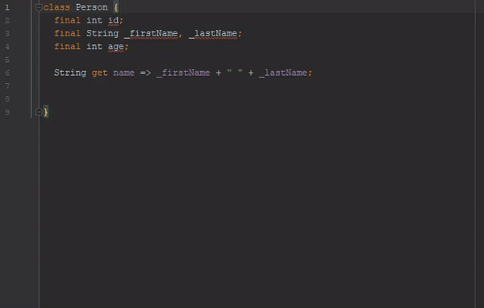
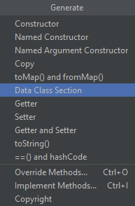
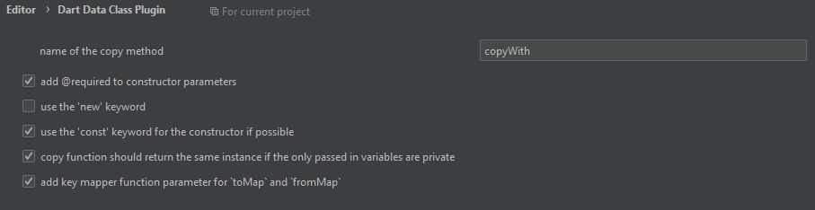

# Dart Data Class Plugin

> **Note**: This is a customized fork ("Dart Data Section NyK") of the original [Dart Data Class Plugin](https://github.com/andrasferenczi/dart-data-plugin) created by **Andras Ferenczi**. Thank you, Andras, for your initiative in creating this wonderful tool! This fork includes modern Dart features such as enhanced Null-Safety, String Interpolation, and robust Timestamp/DateTime support.



This plugin is created for those who would like to have extra data manipulation methods in their data classes without having to write boilerplate code.



This plugin can generate the following code:
- Named Argument Constructor
- `copyWith`: copies the instance and overrides the given parameters
- `toMap`: converts your class into a map of `Map<String, dynamic>`
- `fromMap`: constructs your class from a `Map<String, dynamic>` using the named argument constructor
- all of the above with `toString`, `equals` (`==` operator), `hashcode`

## Example

Let's say you have a class called `Person` with the properties:

```dart
class Person {
  final String id;
  final String nombre;
  final int? edad;
  final String? direccion;
  final DateTime fechaNacimiento;
}
```

Using all generators of this plugin and selecting all properties, this class will look like the following. 

*(Note that some features of this generation can be customized, see details below, and it includes robust parsing for dates like Firestore's Timestamp!)*


```dart
class Person {
  final String id;
  final String nombre;
  final int? edad;
  final String? direccion;
  final DateTime fechaNacimiento;

//<editor-fold desc="Data Methods">
  const new({
    required this.id,
    required this.nombre,
    this.edad,
    this.direccion,
    required this.fechaNacimiento,
  });

  @override
  bool operator ==(Object other) =>
      identical(this, other) ||
      (other is Person &&
          runtimeType == other.runtimeType &&
          id == other.id &&
          nombre == other.nombre &&
          edad == other.edad &&
          direccion == other.direccion &&
          fechaNacimiento == other.fechaNacimiento);

  @override
  int get hashCode =>
      id.hashCode ^
      nombre.hashCode ^
      edad.hashCode ^
      direccion.hashCode ^
      fechaNacimiento.hashCode;

  @override
  String toString() {
    return 'Person{id: $id, nombre: $nombre, edad: $edad, direccion: $direccion, fechaNacimiento: $fechaNacimiento}';
  }

  Person copyWith({
    String? id,
    String? nombre,
    int? edad,
    String? direccion,
    DateTime? fechaNacimiento,
  }) {
    return Person(
      id: id ?? this.id,
      nombre: nombre ?? this.nombre,
      edad: edad ?? this.edad,
      direccion: direccion ?? this.direccion,
      fechaNacimiento: fechaNacimiento ?? this.fechaNacimiento,
    );
  }

  Map<String, dynamic> toMap() {
    return {
      'id': id,
      'nombre': nombre,
      'edad': edad,
      'direccion': direccion,
      'fechaNacimiento': fechaNacimiento,
    };
  }

  factory Person.fromMap(Map<String, dynamic> map) {
    return Person(
      id: map['id'] as String? ?? '',
      nombre: map['nombre'] as String? ?? '',
      edad: (map['edad'] as num?)?.toInt(),
      direccion: map['direccion'] as String?,
      fechaNacimiento: map['fechaNacimiento'] != null
          ? (map['fechaNacimiento'] is DateTime
                ? map['fechaNacimiento'] as DateTime
                : (map['fechaNacimiento'].runtimeType.toString() == 'Timestamp'
                      ? (map['fechaNacimiento'] as dynamic).toDate() as DateTime
                      : DateTime.parse(map['fechaNacimiento'].toString())))
          : DateTime.now(),
    );
  }

//</editor-fold>
}
```

## Settings



You can find additional settings under `Settings` > `Editor` > `Dart Data Class Plugin` where you have the following customization options:

- set the name of the copy method
- use `@required` annotation
- use `new` keyword when instantiation
- use the `const` keyword for the constructor generation - all fields in the class have to be final
- copy function can be specified to return the same instance. This Option has the same requirement as the const keyword. Useful when using Dart in a Redux architecture.
- key mapper for `toMap` and `fromMap` - use your own logic to transform the keys to their original values - useful when database result returns prefixed or uppercased result


#### Under the hood

This project is built using Kotlin and makes use of IntelliJ's PSI elements for extracting the structure of the Dart file of your selection.

### Known issues

- If the class ends with a single-line comment, code is generated from an invalid location
