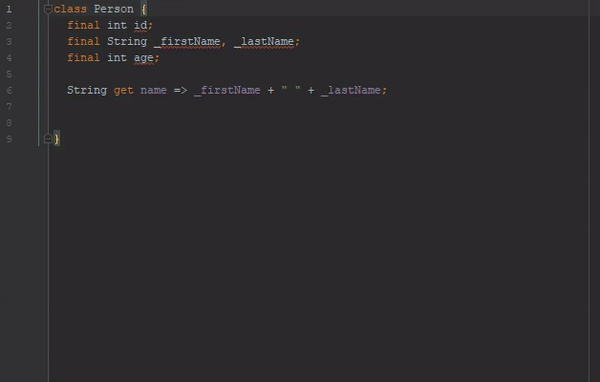
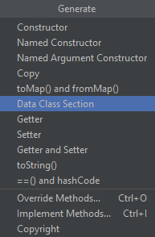
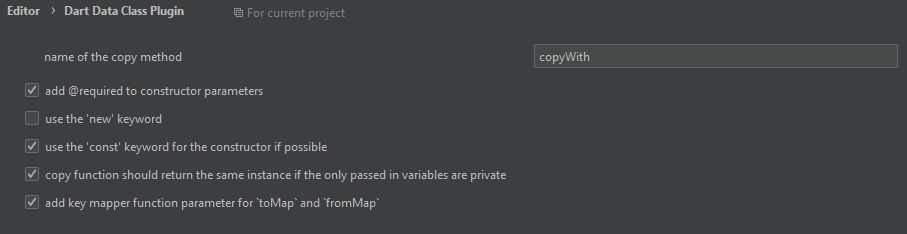

# Dart Data Section NyK

> **Note**: This is a customized fork ("Dart Data Section NyK") of the original [Dart Data Class Plugin](https://github.com/andrasferenczi/dart-data-plugin) created by **Andras Ferenczi**. Thank you, Andras, for your initiative in creating this wonderful tool! This customized version, maintained by **Ing. Juan Pablo Gosalvez**, includes modern Dart features such as enhanced Null-Safety, string interpolation, robust Firestore `Timestamp`/`DateTime` parsing, and full compatibility with recent Android Studio and IntelliJ releases.



This plugin is created for developers who want to generate additional data manipulation methods in their Dart classes without writing repetitive boilerplate code.



## Key Features

This plugin automatically generates:
- **Named Argument Constructor:** With support for `required`, default values, `const` constructor, and Null-Safety.
- **`copyWith`:** Copies the instance overriding only specified arguments, with immutable instance reuse optimization.
- **`toMap`:** Serializes your class into a `Map<String, dynamic>`.
- **`fromMap`:** Reconstructs your class from a `Map<String, dynamic>` using named arguments and robust type handling (including `DateTime` and Firestore `Timestamp`).
- **`toString`:** Human-readable output with modern Dart string interpolation.
- **`equals` (`operator ==`) and `hashCode`:** Accurate property value comparison.
- **Consolidated "Dart Data Section NyK":** Groups all aforementioned methods inside a collapsible `<editor-fold desc="Data Methods">` block.

---

## Complete Example

Given a Dart class with properties of varying types and nullability:

```dart
class Person {
  final String id;
  final String nombre;
  final int? edad;
  final String? direccion;
  final DateTime fechaNacimiento;
}
```

Triggering the **Dart Data Section NyK** action (`Alt + Insert` or context menu `Generate...` > `Dart Data Section NyK`) and selecting all fields generates the following clean code:

```dart
class Person {
  final String id;
  final String nombre;
  final int? edad;
  final String? direccion;
  final DateTime fechaNacimiento;

//<editor-fold desc="Data Methods">
  const Person({
    required this.id,
    required this.nombre,
    this.edad,
    this.direccion,
    required this.fechaNacimiento,
  });

  @override
  bool operator ==(Object other) =>
      identical(this, other) ||
      (other is Person &&
          runtimeType == other.runtimeType &&
          id == other.id &&
          nombre == other.nombre &&
          edad == other.edad &&
          direccion == other.direccion &&
          fechaNacimiento == other.fechaNacimiento);

  @override
  int get hashCode =>
      id.hashCode ^
      nombre.hashCode ^
      edad.hashCode ^
      direccion.hashCode ^
      fechaNacimiento.hashCode;

  @override
  String toString() {
    return 'Person{id: $id, nombre: $nombre, edad: $edad, direccion: $direccion, fechaNacimiento: $fechaNacimiento}';
  }

  Person copyWith({
    String? id,
    String? nombre,
    int? edad,
    String? direccion,
    DateTime? fechaNacimiento,
  }) {
    return Person(
      id: id ?? this.id,
      nombre: nombre ?? this.nombre,
      edad: edad ?? this.edad,
      direccion: direccion ?? this.direccion,
      fechaNacimiento: fechaNacimiento ?? this.fechaNacimiento,
    );
  }

  Map<String, dynamic> toMap() {
    return {
      'id': id,
      'nombre': nombre,
      'edad': edad,
      'direccion': direccion,
      'fechaNacimiento': fechaNacimiento,
    };
  }

  factory Person.fromMap(Map<String, dynamic> map) {
    return Person(
      id: map['id'] as String? ?? '',
      nombre: map['nombre'] as String? ?? '',
      edad: (map['edad'] as num?)?.toInt(),
      direccion: map['direccion'] as String?,
      fechaNacimiento: map['fechaNacimiento'] != null
          ? (map['fechaNacimiento'] is DateTime
                ? map['fechaNacimiento'] as DateTime
                : (map['fechaNacimiento'].runtimeType.toString() == 'Timestamp'
                      ? (map['fechaNacimiento'] as dynamic).toDate() as DateTime
                      : DateTime.parse(map['fechaNacimiento'].toString())))
          : DateTime.now(),
    );
  }

//</editor-fold>
}
```

---

## Settings



You can find advanced settings under **Settings / Preferences** > **Editor** > **Dart Data Class Plugin**:

- **Copy method name:** Customize the method identifier (defaults to `copyWith`).
- **Use `@required`:** Enable/disable the `@required` annotation.
- **Use `new` keyword:** Toggle the `new` keyword on instantiations.
- **Use `const` keyword:** Automatically generate `const` constructors when all class fields are `final`.
- **Optimized copy function:** Return the same instance when no parameters are changed on immutable classes.
- **Key mapper for `toMap` and `fromMap`:** Configure custom naming transform logic.

---

## Architecture & Technical Compatibility

- **Runtime Environment:** Compatible with **Android Studio 2024.1 (Koala)** through **Build 262+** (and future builds with JBR OpenJDK 25 on Windows).
- **Build System:** **Gradle 9.9.0** with **Kotlin 2.1.20**.
- **JVM Target:** Java 17 bytecode compatibility (`jvmTarget = 17`).
- **Safe Threading:** All actions explicitly execute on the platform's background thread (`ActionUpdateThread.BGT`) to eliminate EDT freezes.
- **Transactional Writes:** Safe modification of documents wrapped in `WriteCommandAction.runWriteCommandAction` with full undo/redo history preservation.

---

## Build & Testing

To run the unit tests and package the distribution:

```bash
# Execute unit tests
./gradlew test

# Clean compile and build distribution artifact
./gradlew clean buildPlugin
```

The packaged distribution file will be available at:
```
build/distributions/dart-data-plugin-1.0.1.zip
```

---

## 📖 Architecture & Developer Guide

For in-depth details about the internal action lifecycle, Dart PSI syntax trees, background execution threading (`ActionUpdateThread.BGT`), and code generation templates, refer to the [Technical Architecture Guide](docs/ARCHITECTURE.md).

