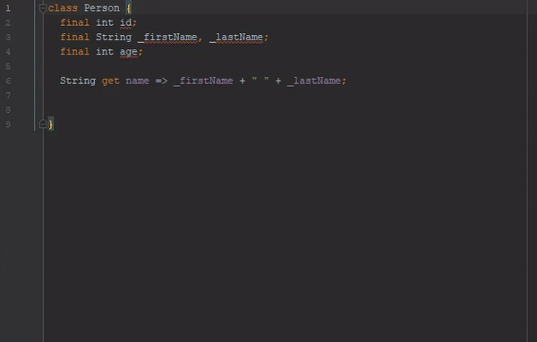
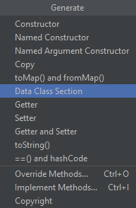
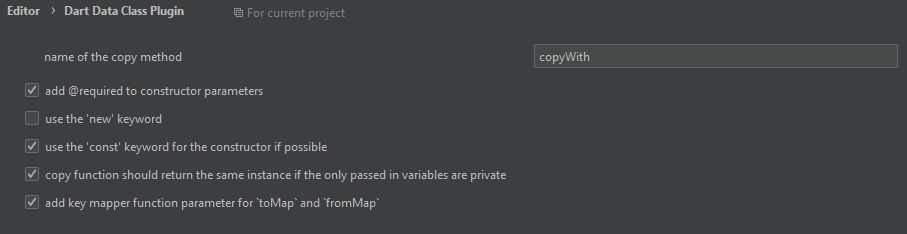

# Dart Data Section NyK

> **Nota**: Este es un fork personalizado ("Dart Data Section NyK") del [Dart Data Class Plugin](https://github.com/andrasferenczi/dart-data-plugin) original creado por **Andras Ferenczi**. ¡Muchas gracias a Andras por su iniciativa al crear esta maravillosa herramienta! Esta versión personalizada incluye características modernas de Dart como Null-Safety mejorado, interpolación de cadenas y soporte robusto para Timestamp/DateTime.



Este plugin está diseñado para aquellos desarrolladores que desean generar métodos adicionales de manipulación de datos en sus clases de Dart sin tener que escribir código repetitivo (boilerplate).



Este plugin puede generar el siguiente código:
- Constructor con argumentos nombrados (*Named Argument Constructor*)
- `copyWith`: copia la instancia sobrescribiendo los parámetros proporcionados.
- `toMap`: convierte tu clase en un `Map<String, dynamic>`.
- `fromMap`: construye tu clase a partir de un `Map<String, dynamic>` utilizando el constructor con argumentos nombrados.
- Todo lo anterior combinado con `toString`, `equals` (operador `==`) y `hashCode`.

## Ejemplo

Supongamos que tienes una clase llamada `Person` con las siguientes propiedades:

```dart
class Person {
  final String id;
  final String nombre;
  final int? edad;
  final String? direccion;
  final DateTime fechaNacimiento;
}
```

Al utilizar todos los generadores de este plugin y seleccionar todas las propiedades, la clase resultante se verá de la siguiente manera:

*(¡Nota que algunas características se pueden personalizar, ver detalles más abajo, e incluye un análisis robusto para fechas como el Timestamp de Firestore!)*

```dart
class Person {
  final String id;
  final String nombre;
  final int? edad;
  final String? direccion;
  final DateTime fechaNacimiento;

//<editor-fold desc="Data Methods">
  const Person({
    required this.id,
    required this.nombre,
    this.edad,
    this.direccion,
    required this.fechaNacimiento,
  });

  @override
  bool operator ==(Object other) =>
      identical(this, other) ||
      (other is Person &&
          runtimeType == other.runtimeType &&
          id == other.id &&
          nombre == other.nombre &&
          edad == other.edad &&
          direccion == other.direccion &&
          fechaNacimiento == other.fechaNacimiento);

  @override
  int get hashCode =>
      id.hashCode ^
      nombre.hashCode ^
      edad.hashCode ^
      direccion.hashCode ^
      fechaNacimiento.hashCode;

  @override
  String toString() {
    return 'Person{id: $id, nombre: $nombre, edad: $edad, direccion: $direccion, fechaNacimiento: $fechaNacimiento}';
  }

  Person copyWith({
    String? id,
    String? nombre,
    int? edad,
    String? direccion,
    DateTime? fechaNacimiento,
  }) {
    return Person(
      id: id ?? this.id,
      nombre: nombre ?? this.nombre,
      edad: edad ?? this.edad,
      direccion: direccion ?? this.direccion,
      fechaNacimiento: fechaNacimiento ?? this.fechaNacimiento,
    );
  }

  Map<String, dynamic> toMap() {
    return {
      'id': id,
      'nombre': nombre,
      'edad': edad,
      'direccion': direccion,
      'fechaNacimiento': fechaNacimiento,
    };
  }

  factory Person.fromMap(Map<String, dynamic> map) {
    return Person(
      id: map['id'] as String? ?? '',
      nombre: map['nombre'] as String? ?? '',
      edad: (map['edad'] as num?)?.toInt(),
      direccion: map['direccion'] as String?,
      fechaNacimiento: map['fechaNacimiento'] != null
          ? (map['fechaNacimiento'] is DateTime
                ? map['fechaNacimiento'] as DateTime
                : (map['fechaNacimiento'].runtimeType.toString() == 'Timestamp'
                      ? (map['fechaNacimiento'] as dynamic).toDate() as DateTime
                      : DateTime.parse(map['fechaNacimiento'].toString())))
          : DateTime.now(),
    );
  }

//</editor-fold>
}
```

## Configuración



Puedes encontrar configuraciones adicionales en `Settings` > `Editor` > `Dart Data Class Plugin` donde tienes las siguientes opciones de personalización:

- Establecer el nombre del método de copia (*copy method*).
- Usar la anotación `@required`.
- Usar la palabra clave `new` al instanciar.
- Usar la palabra clave `const` para la generación del constructor (todos los campos de la clase deben ser `final`).
- Configurar la función de copia para retornar la misma instancia (útil cuando se usa Dart en una arquitectura Redux).
- Mapeador de claves para `toMap` y `fromMap`: aplica tu propia lógica para transformar las claves a sus valores originales.

## Bajo el capó

Este proyecto está construido en Kotlin y hace uso de los elementos PSI de IntelliJ para extraer la estructura del archivo Dart seleccionado.

## Problemas conocidos

- Si la clase termina con un comentario de una sola línea, el código puede generarse desde una ubicación no válida.
