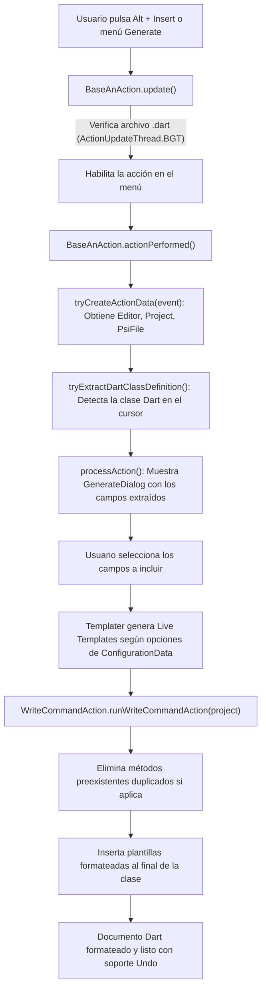

# 🏛️ Arquitectura y Guía Técnica del Proyecto - Dart Data Section NyK

Este documento describe la arquitectura interna, diseño de módulos, flujo de ejecución y directrices para desarrolladores y mantenedores futuros de **Dart Data Section NyK**.

---

## 🎯 1. Propósito del Proyecto

**Dart Data Section NyK** es un plugin para el ecosistema **IntelliJ Platform / Android Studio** diseñado para eliminar el código repetitivo (*boilerplate*) en aplicaciones Dart y Flutter. 

El plugin inspecciona clases de Dart abiertas en el editor y genera de forma automática, precisa y segura:
- Constructor con parámetros nombrados (`required`, `const`, y Null-Safety).
- Método `copyWith` (con optimización de identidad inmutable).
- Métodos de serialización `toMap` y deserialización `fromMap` (con parseo robusto para tipos primitivos, `DateTime` y `Timestamp` de Cloud Firestore).
- Métodos estándar `toString()`, `operator ==` y `hashCode`.
- Todo agrupado de forma ordenada dentro de un pliegue colapsable `<editor-fold desc="Data Methods">`.

---

## 🧱 2. Pila Tecnológica y Entorno del Sistema

| Componente | Versión / Especificación |
|---|---|
| **Lenguaje de Desarrollo** | Kotlin `2.1.20` |
| **Plataforma Objetivo** | IntelliJ Platform Gradle Plugin `2.20.0` |
| **Base IDE** | Android Studio `2024.1.1.13` (Koala) / IntelliJ `241+` |
| **Compatibilidad Retroactiva y Futura** | `since-build = "241"`, `untilBuild = null` (soporta Builds 241, 242, 243, 251, 252, 253, 262+) |
| **Gradle** | `9.9.0` (fijado en `gradle-wrapper.properties`) |
| **Java / JVM Bytecode** | Java `17` (`sourceCompatibility`, `targetCompatibility`, `jvmTarget = 17`) |
| **Entorno de Ejecución Host** | Compatible con JBR OpenJDK 17 a 25 en Windows/Linux/macOS |

---

## 📂 3. Estructura de Directorios del Código Fuente

```text
src/main/
├── kotlin/com/nyk/
│   ├── action/                 # Acciones de IntelliJ (menús e interacción de usuario)
│   │   ├── BaseAnAction.kt     # Clase base abstracta con ActionUpdateThread.BGT y WriteCommandAction
│   │   ├── FullDataAction.kt   # Acción principal que genera la sección completa consolidada
│   │   ├── NamedArgumentConstructorAction.kt # Acción para constructor nombrado
│   │   ├── DartCopyWithAction.kt             # Acción para método copyWith
│   │   ├── MapAction.kt                      # Acción para toMap() y fromMap()
│   │   ├── my/                 # Generadores individuales para toString, equals y hashCode
│   │   ├── data/               # Estructuras de datos intercambiadas entre acciones (GenerationData, PerformAction)
│   │   ├── init/               # Extracción de contexto (ActionData, DartClassDefinition)
│   │   └── utils/              # Procesos de eliminación/reemplazo y diálogo de selección de campos
│   ├── configuration/          # Configuración persistente del plugin (Settings > Editor > Dart Data Class Plugin)
│   │   ├── ConfigurationData.kt        # Modelo de datos y valores por defecto
│   │   ├── ConfigurationDataManager.kt # Persistencia vía PropertiesComponent de IntelliJ
│   │   ├── ConfigurationUIElements.kt  # Componentes Swing de configuración
│   │   ├── DataClassConfigurable.kt    # Integración con el panel de Settings de IntelliJ
│   │   └── configurationUI.kt          # Construcción visual de la UI de configuración
│   ├── constants/              # Constantes generales
│   ├── declaration/            # Análisis de sintaxis PSI de variables de Dart
│   │   ├── DeclarationExtractor.kt         # Extracción de campos y resolución de nombres públicos/privados
│   │   ├── DeclarationModifier.kt          # Modificadores (final, const, static)
│   │   └── VariableDeclarationPsiElements.kt # Abstracción sobre elementos PSI de Dart
│   ├── dialog/                 # Cuadros de diálogo interactivos (ej. selección de campos)
│   ├── ext/                    # Extensiones Kotlin para IntelliJ PSI, Editor, TemplateManager y Swing
│   ├── templater/              # Constructores de plantillas de código Dart (Live Templates)
│   │   ├── constructorTemplate.kt # Generación de sintaxis de constructores
│   │   ├── copyWithTemplate.kt    # Generación de método copyWith
│   │   ├── mapTemplate.kt         # Generación de toMap y fromMap (Firestore Timestamp/DateTime)
│   │   ├── equalsTemplate.kt      # Generación de operador ==
│   │   ├── hashcodeTemplate.kt    # Generación de getter hashCode
│   │   └── toStringTemplate.kt    # Generación de toString con interpolación
│   ├── traversal/              # Utilidades de recorrido BFS/DFS en árboles PSI
│   └── utils/                  # Extensiones de colecciones y utilidades varias
└── resources/
    └── META-INF/
        ├── plugin.xml          # Descriptor oficial del plugin para IntelliJ
        ├── pluginIcon.svg      # Ícono institucional (modo claro, 40x40)
        └── pluginIcon_dark.svg # Ícono institucional adaptado a modo oscuro (40x40)
```

---

## 🔄 4. Flujo de Ejecución del Plugin



### Reglas Críticas de Concurrencia y Threading
1. **Background Threading (`BGT`):**
   Todas las clases de acción heredan de [`BaseAnAction`](file:///C:/Users/ingej/StudioProjects/dart-data-plugin-master/src/main/kotlin/com/nyk/action/BaseAnAction.kt) e implementan:
   ```kotlin
   override fun getActionUpdateThread(): ActionUpdateThread = ActionUpdateThread.BGT
   ```
   Esto evita que la validación del estado del menú congele el hilo de interfaz de usuario (**EDT**) del IDE.
2. **Acceso Seguro a Escritura:**
   Toda modificación del documento Dart se ejecuta dentro de:
   ```kotlin
   WriteCommandAction.runWriteCommandAction(project) { ... }
   ```
   Asegurando atomicidad y compatibilidad nativa con `Ctrl + Z` (Deshacer) y `Ctrl + Y` (Rehacer).

---

## ⚙️ 5. Lógica Especial de Parseo en `fromMap` (`mapTemplate.kt`)

Una de las grandes mejoras introducidas en esta versión es el soporte híbrido de fechas en Dart/Flutter:

```dart
// Soporta tanto DateTime nativo como Timestamp de Cloud Firestore o strings ISO-8601:
fechaNacimiento: map['fechaNacimiento'] != null
    ? (map['fechaNacimiento'] is DateTime
          ? map['fechaNacimiento'] as DateTime
          : (map['fechaNacimiento'].runtimeType.toString() == 'Timestamp'
                ? (map['fechaNacimiento'] as dynamic).toDate() as DateTime
                : DateTime.parse(map['fechaNacimiento'].toString())))
    : DateTime.now(),
```
Esta lógica evita la necesidad de importar paquetes externos pesados directamente dentro del motor de generación y no falla si los datos provienen de una API REST (cadena ISO) o de Firebase (`Timestamp`).

---

## 🛠️ 6. Ciclo de Compilación y Mantenimiento

### Comandos de Terminal Disponibles
```bash
# 1. Ejecutar las pruebas unitarias:
./gradlew test

# 2. Compilar con estricto 'allWarningsAsErrors':
./gradlew clean compileKotlin compileTestKotlin

# 3. Empaquetar el archivo ZIP final de distribución:
./gradlew clean buildPlugin
```

### Ubicación del Artefacto Final
El archivo empaquetado resultante se almacena en:
```text
build/distributions/dart-data-plugin-1.0.1.zip
```
Este archivo ZIP se puede instalar directamente en Android Studio o IntelliJ a través de:
`Settings > Plugins > ⚙️ > Install Plugin from Disk...`.

---

## 📌 7. Buenas Prácticas para Futuros Desarrolladores

1. **Mantener `kotlin.stdlib.default.dependency=false` en `../gradle.properties`:**
   Evita conflictos de versiones de stdlib entre el runtime de IntelliJ y las dependencias del plugin.
2. **Desactivar tareas `buildSearchableOptions` y `prepareJarSearchableOptions`:**
   En Windows, estas tareas pueden fallar al procesar caracteres de escape o iniciar instancias headless innecesarias.
3. **No utilizar APIs de texto obsoletas:**
   - Usar `replaceFirstChar { it.lowercase() }` y `replaceFirstChar { it.uppercase() }` en lugar de `decapitalize()` o `capitalize()`.
4. **Respetar la arquitectura de plantillas:**
   Cualquier nuevo método a generar debe agregarse como una función pura en el paquete `templater` que reciba un objeto de parámetros y devuelva una `Template` de IntelliJ.
